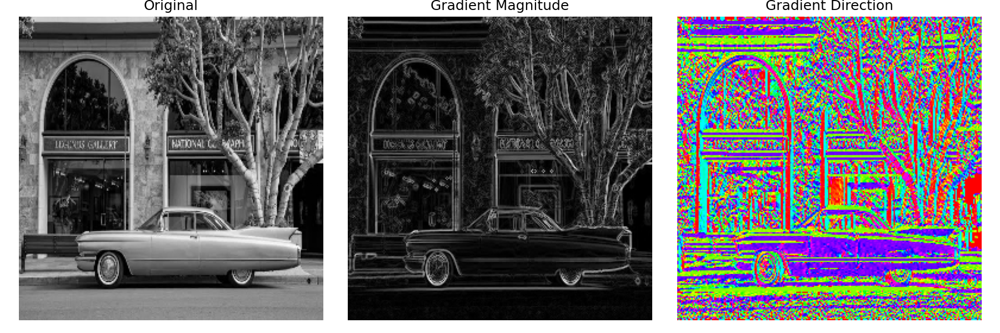
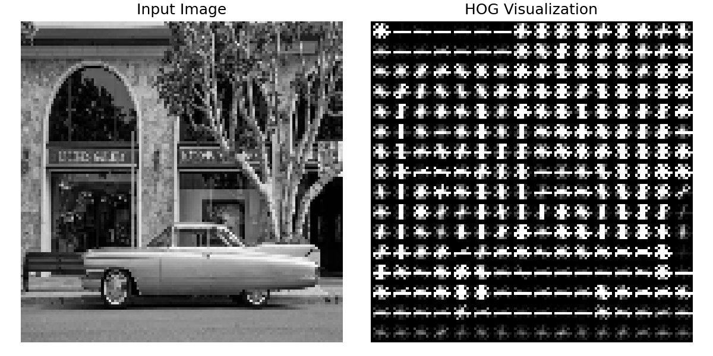

# Week 2 Lab Report — HOG Features + Simple Classifier

**Course:** Image and Scene Recognition, Department of Smart Computing, Kyungdong University
**Author:** Samundra

## Part 1 — Image Gradients



**Reflection Question 1:** Look at the gradient magnitude image. Which parts of the photo appear brightest, and why do edges and object boundaries tend to produce strong gradients while flat, uniform regions (like a clear sky) do not?

The brightest areas of the gradient magnitude image are along the edges of the car, the building's arches and window frames, and the tree's silhouette — anywhere the pixel intensity changes sharply over a short distance. A gradient measures the rate of change in brightness between neighboring pixels, so at an edge or object boundary (light car body against a dark background, or a window frame against a wall) that change is large, producing a strong gradient magnitude. In flat, uniform regions like a clear sky or a plain wall, neighboring pixels have nearly identical intensity, so the rate of change — and therefore the gradient magnitude — is close to zero, which is why those regions appear dark in the magnitude image.

## Part 2 — Extracting HOG Features



HOG feature vector shape: **(8100,)** for a 128×128 image with `orientations=9`, `pixels_per_cell=(8, 8)`, `cells_per_block=(2, 2)`, `block_norm='L2-Hys'`.

**Reflection Question 2:** If you increase `pixels_per_cell` from (8, 8) to (16, 16), do you expect the resulting feature vector to get longer or shorter, and what does that mean for the level of spatial detail captured?

Increasing `pixels_per_cell` from (8, 8) to (16, 16) makes each cell cover a larger area of the image, which means fewer cells fit into the same image — and therefore **fewer, larger blocks**, resulting in a **shorter** feature vector. Each cell's histogram now summarizes gradient orientations over a bigger patch of pixels, so fine local detail (small edges, texture) gets averaged away and the descriptor captures coarser, more global shape information instead. This trades spatial precision for a smaller, faster-to-compute feature vector.

## Part 4 — Training a Simple Classifier on HOG Features

Dataset: 80 samples (cats, dogs, birds), 8100 features each. 75/25 train/test split (20 test samples).

**Accuracy: 0.60**

**Classification Report:**

| Class | Precision | Recall | F1-score | Support |
|---|---|---|---|---|
| birds | 0.75 | 0.50 | 0.60 | 6 |
| cats | 0.62 | 0.71 | 0.67 | 7 |
| dogs | 0.50 | 0.57 | 0.53 | 7 |
| **accuracy** | | | **0.60** | 20 |

**Confusion Matrix** (rows = true, columns = predicted; order: birds, cats, dogs):

```
              pred_birds  pred_cats  pred_dogs
true_birds         3          1          2
true_cats          0          5          2
true_dogs          1          2          4
```

**Reflection Question 3:** Look at your confusion matrix. Are misclassifications spread evenly, or concentrated between specific pairs of categories? What visual similarities between those categories might explain the confusion?

Misclassifications are not evenly spread — they concentrate between **cats and dogs** (2 cats misclassified as dogs, 2 dogs misclassified as cats) and between **birds and dogs** (2 birds misclassified as dogs), while birds and cats are rarely confused with each other. This makes sense given what HOG actually captures: it's a shape/edge descriptor with no color or fine texture information, so cats and dogs — which share similar body outlines, four-legged poses, and fur silhouettes at a resized 128×128 scale — are hard for it to tell apart. The birds-as-dogs confusion likely comes from certain bird poses (e.g., a perched or hunched bird) producing a rounded silhouette similar to a small dog's outline. With only 80 total images (20 in the test set), these results should be read as a general trend rather than a precise measurement — a larger dataset would give a more reliable picture.

## Wrap-Up

This lab moved from raw image gradients, to a full HOG descriptor, to training a Linear SVM classifier on top of those hand-crafted features. Compared to the pretrained ResNet-18 used in Week 1, HOG + SVM is lightweight, fast, and fully interpretable (you can literally see what the descriptor captured), but tops out at a lower accuracy on a visually similar, small dataset — motivating why the field moved toward deep learning for complex recognition tasks.
